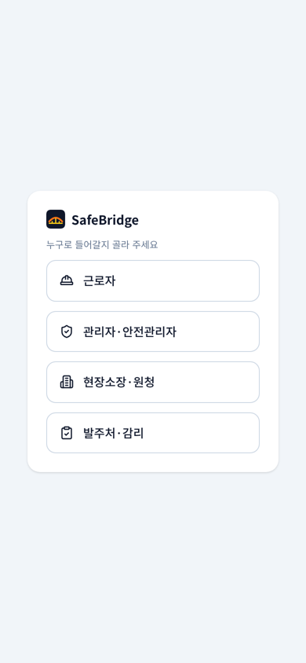
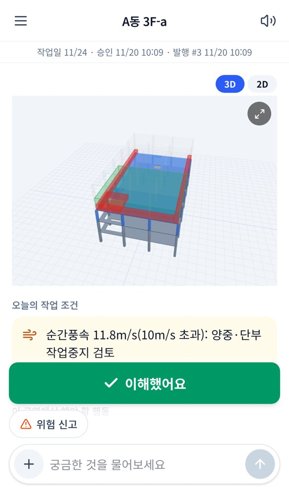
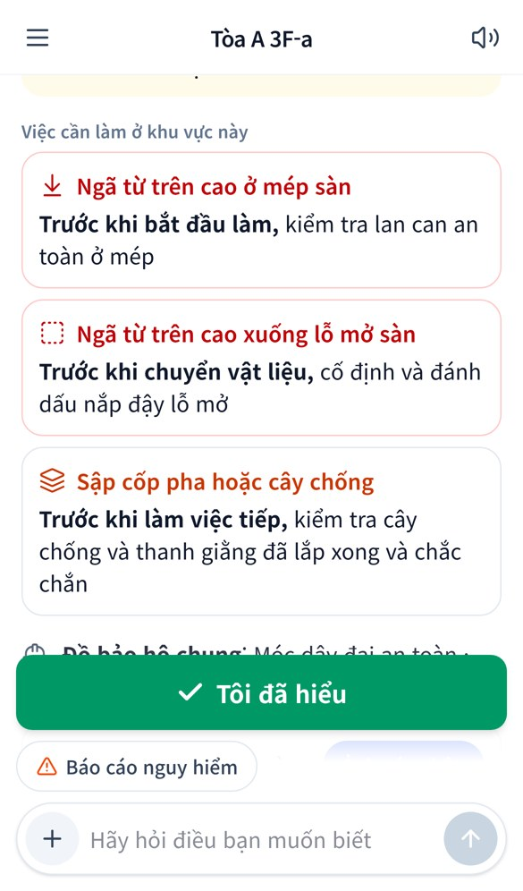
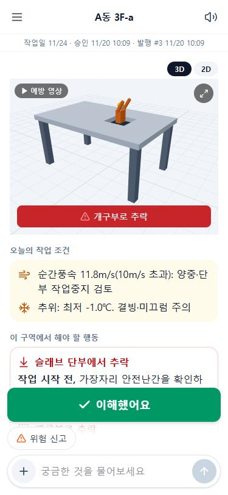
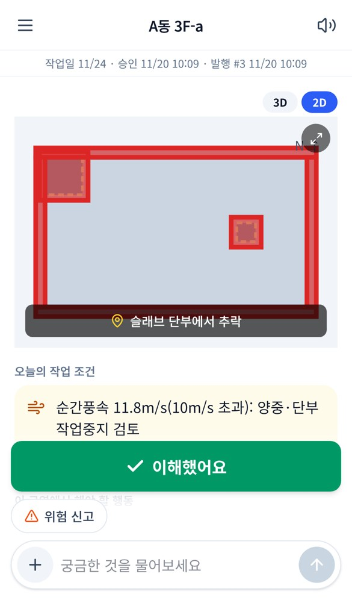
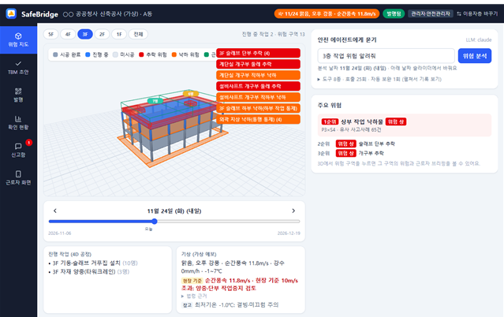

# SafeBridge 세이프브릿지

> 외국인 건설근로자에게 **오늘 내 구역의 위험**을 **모국어로** 전하는 AI 안전 TBM 에이전트
>
> 2026 대한민국 청년 CAREER FAIR AI 해커톤 출품작

**바로 써 보기:** <https://safebridge-mgqp.onrender.com>
(로그인 없이 첫 화면에서 이용자층을 고르면 들어갑니다. 근로자 앱은 [`/app`](https://safebridge-mgqp.onrender.com/app))

---

## 목차

1. [프로젝트 소개](#1-프로젝트-소개)
2. [주요 기능](#2-주요-기능)
3. [화면](#3-화면)
4. [시스템 아키텍처](#4-시스템-아키텍처)
5. [기술 스택 · 개발 환경](#5-기술-스택--개발-환경)
6. [폴더(모듈) 구조](#6-폴더모듈-구조)
7. [설치 및 실행](#7-설치-및-실행)
8. [사용 방법 (시연 흐름)](#8-사용-방법-시연-흐름)
9. [테스트 · 검증 현황](#9-테스트--검증-현황)
10. [알려진 한계](#10-알려진-한계)
11. [개발 기간 · 팀](#11-개발-기간--팀)
12. [Credits / Licenses](#12-credits--licenses)

---

## 1. 프로젝트 소개

### 문제

건설현장의 외국인 근로자는 매일 아침 TBM(작업 전 안전점검)과 안전교육을 받지만, 한국어로 진행되는 설명을 제대로 이해하기 어렵습니다.
신입 현장관리자도 그날 공정·날씨·구역에 맞는 위험성평가를 빠르게 만들기 어렵습니다. 그 결과 **"교육은 했지만 전달은 되지 않은"** 안전교육 공백이 생깁니다.

### 해결

SafeBridge는 이 공백을 두 단계로 잇습니다.

1. **관리자 쪽:** "내일 3층 작업 위험 알려줘"라고 물으면 AI 에이전트가 4D 공정·BIM 공간 위험·공공 사고사례·기상·조문을 도구로 조회해 **근거가 달린 위험성평가 초안**을 만듭니다. 관리자가 검토·수정·승인하면 **구역별로 발행**합니다.
2. **근로자 쪽:** 구역 입구의 **QR 또는 NFC 태그**에 휴대폰을 대면, 그 구역의 오늘 브리핑이 **10개 언어**와 음성, 3D/2D 사고 재현 영상으로 열립니다. 궁금한 점은 챗봇에 모국어로 묻고, 위험은 사진과 함께 신고합니다.

### 설계 원칙

**숫자·위치·판정은 코드가, 해석·작성은 AI가.**
위험 영역 계산, 위험도 순위, 기상 판정, 브리핑 카드 번역(문장 은행)은 결정론적인 코드가 맡습니다.
LLM은 도구 선택, 설명 문장 작성, 승인된 브리핑 안에서의 질문 답변, 신고 번역·분류만 맡습니다. 근거가 없는 항목은 '확인 불가'로 표시합니다.

---

## 2. 주요 기능

### 관리자 (안전관리자 · 현장소장 · 발주처/감리)

| 기능 | 설명 |
|---|---|
| **AI 위험성평가 초안** | LLM tool calling 에이전트가 도구 8개(진행 작업, 위험 구역, 위험 규칙, 유사 사망사고, KOSHA GUIDE, 근거 조문, 기상, 사고 통계)를 호출. 빠진 필수 도구는 코드가 보완 호출하고, 모든 항목에 근거 ID를 붙임 |
| **위험 순위** | R = 사고가능성 P × 심각성 S × 공종 사고 빈도 w + 기상 보정, 상위 5개 |
| **3D 위험구역 지도** | 샘플 IFC 모델 위에 날짜별 공정 상태와 추락(빨강)·낙하(주황) 영역 표시, 클릭하면 근거 |
| **검토 · 승인 · 발행** | 초안 항목·대책 수정 → 현장소장 승인 → 구역별 브리핑 발행(구역 QR 인쇄, NFC 태그 쓰기) |
| **유사사례 검색** | 공공 사고사례 3,484건에서 문자 2-gram TF-IDF로 유사 사망사고 검색(안전보건공단 유의어사전으로 검색어 확장) |
| **신고함 · 사진함** | 근로자 신고를 긴급도 순으로 정리, 한국어로 회신하면 근로자 언어로 번역해 전달. 안전시설 사진 증빙 확인 |
| **확인 현황** | 언어별 '이해했어요' 비율, 대면 재설명이 필요한 언어 표시 |
| **이용자층별 화면** | 안전관리자(분석·수정·발행), 현장소장(승인), 발주처·감리(보기 전용). 휴대폰용 '오늘' 홈 |

### 근로자

| 기능 | 설명 |
|---|---|
| **QR/NFC 구역 입장** | 로그인·가입 없이 구역 태그로 접속(직접 구역 선택도 가능) |
| **10개 언어 브리핑** | 한국어·영어·중국어·베트남어·태국어 + 네팔어·몽골어·라오어·테툼어·미얀마어. 작업 조건(날씨), 시점이 있는 행동 카드("작업 시작 전, …"), 출입통제 배너, 공통 보호구, 음성 읽기 |
| **3D/2D 자동 사고 재현** | 내 구역 3D 모델·평면도에서 위험 위치를 짚고, 사고 4종(슬래브 단부 추락, 개구부 추락, 낙하물, 붕괴)을 재현 영상으로 보여 줌 |
| **현장 챗봇** | 승인된 브리핑을 근거로만 모국어 답변(근거 밖이면 "반장에게 확인"). 출입금지·행동·보호구 근거 제시, 예보 기온으로 더위(33℃ 이상)·추위(0℃ 이하) 답변 |
| **위험 신고 · 사진 증빙** | 신고를 한국어로 번역·요약·긴급도 판정 후 담당자에게 전달, 회신은 모국어로 표시. 사진은 촬영정보(EXIF·GPS) 삭제와 얼굴 흐림 후 저장 |
| **예방 영상** | 안전보건공단(KOSHA) 안전보건자료 영상 링크 |

### 외부 연동

- **기상청 단기예보 API**: 작업일 바람·강수·기온으로 작업중지 검토 판정(키가 없으면 가상 예보)
- **KOSHA 안전보건자료 API**: 구역 위험에 맞는 예방 영상
- **법제처 국가법령정보 API**: 「산업안전보건기준에 관한 규칙」 원문 조회(키가 없으면 팀 요약 조문)
- **Claude API** (`claude-sonnet-5-5`): 에이전트·챗봇·번역. 설정 한 줄로 Ollama 로컬 모델이나 mock(오프라인)으로 교체 가능

---

## 3. 화면

| 첫 화면 (이용자층 선택) | 근로자 브리핑 (한국어) | 근로자 브리핑 (베트남어) |
|:---:|:---:|:---:|
|  |  |  |

| 3D 사고 재현 | 2D 사고 재현 |
|:---:|:---:|
|  |  |

**관리자 위험 지도** (3D 위험구역 · 날짜 슬라이더 · 안전 에이전트 질의 · 주요 위험 순위)



---

## 4. 시스템 아키텍처

```
[데이터]   공공 사고사례·위험요소 프로파일·통계·유의어·KOSHA GUIDE (scripts/public_data 로 JSON 변환)
           샘플 IFC 모델(engine)   기상청 예보 / 가상 예보   조문(법제처 / 팀 요약)
                │
                ▼
[도구 8개]  진행 작업(4D) · 위험 구역(BIM) · 위험 규칙(P·S) · 유사사례(TF-IDF) · KOSHA GUIDE · 조문 · 기상 · 사고 통계(w)
                │
                ▼
[에이전트]  LLM tool calling 루프 → 필수 도구 보완 → 초안 골격(코드) → 위험 순위 → 구역별 브리핑 골격
            → LLM 이 설명·대책 작성 → 병합 (모든 항목에 근거 ID)
                │
                ▼
[관리자]    검토·수정 → 승인(현장소장) → 구역별 발행: 10개 언어 카드(문장 은행) + 평면도 + QR/NFC
                │
                ▼
[근로자]    QR/NFC → 언어·구역 브리핑·음성·사고 재현 → 챗봇(브리핑 안에서만) · 신고/사진 → 번역 회신
```

- **한 서버 배포:** FastAPI가 API와 빌드된 React 화면을 같은 주소에서 냅니다(`backend/app/web/spa.py`).
- **LLM 공급자 분리:** 에이전트는 `LLMProvider` 인터페이스만 쓰고, `claude`·`ollama`·`mock` 구현이 메시지 형식을 맞춥니다(`backend/app/llm/`).
- 자세한 내용: [docs/ARCHITECTURE.md](docs/ARCHITECTURE.md), 배포: [docs/deploy.md](docs/deploy.md)

---

## 5. 기술 스택 · 개발 환경

| 구분 | 사용 기술 |
|---|---|
| Backend | Python 3.13, FastAPI, Uvicorn, SQLAlchemy(SQLite), Pydantic |
| BIM · 3D | IfcOpenShell(IFC 생성·추출), three.js |
| AI | Claude API(`claude-sonnet-5-5`, Anthropic SDK) / Ollama(`qwen3:8b`) / mock, 문자 2-gram TF-IDF 유사사례 검색 |
| 사진 처리 | OpenCV(얼굴 흐림, 재인코딩으로 EXIF·GPS 삭제) |
| Frontend | React 19, TypeScript, Vite, Tailwind CSS 4, React Router, lucide-react 아이콘, qrcode, Web Speech API(음성), Web NFC |
| 테스트 · CI | pytest, vitest, GitHub Actions(백엔드 pytest + 프런트 타입검사·vitest·빌드) |
| 배포 | Docker, Render(Blueprint `render.yaml`, 1GB 디스크에 DB·사진 보관) |
| 개발 도구 | Claude Code(AI 코딩 도구), Git/GitHub(기능별 PR) |

---

## 6. 폴더(모듈) 구조

기능별로 모듈을 나눴습니다. 백엔드는 `engine`(웹과 무관한 계산) → `services`(도메인 로직) → `agent`(LLM 루프·도구) → `api`(라우터) 순으로 의존합니다.

```
safebridge/
├─ backend/
│  ├─ engine/              샘플 IFC 생성 · IFC 추출 · 4D 공정 생성 · 공간 위험 계산 (웹·DB 독립)
│  ├─ app/
│  │  ├─ core/             설정(SAFEBRIDGE_*) · DB · '오늘'(시간대·시연 날짜 고정)
│  │  ├─ models/           SQLAlchemy 테이블 (위험성평가 · TBM · 확인 · 신고 · 사진)
│  │  ├─ llm/              공급자 인터페이스 + claude · ollama · mock + factory
│  │  ├─ agent/            에이전트 루프(runner) · 프롬프트 · 브리핑 · tools/ (도구 8개)
│  │  ├─ services/         bim · schedule · risk · patterns(TF-IDF) · weather·kma · law·law_api
│  │  │                    glossary · translate · tbm · zone_brief · brief_actions · field_chat
│  │  │                    chat_weather · issues · photos·photo_check · videos·kosha_media
│  │  ├─ api/              FastAPI 라우터 (bim · reference · assessments · worker · field · issues · photos · admin …)
│  │  ├─ web/              빌드된 프런트엔드 서빙 (한 서버 배포)
│  │  └─ main.py           API 진입점
│  ├─ data/                공공데이터 변환 JSON · 조문 요약 · 가상 예보 · 용어 사전 · 카드 문장 은행 · 현장/구역(site.json)
│  ├─ scripts/             공공데이터 변환 · 사고사례 구조화 · 정확도 평가 · 샘플 IFC · 기상청 점검 · 시연 데이터
│  ├─ samples/             샘플 IFC (가상, 생성기로 재현 가능)
│  ├─ seed/                클라우드 첫 기동용 시연 DB 사본
│  └─ tests/               pytest
├─ frontend/src/
│  ├─ features/
│  │  ├─ entry/            이용자층 선택
│  │  ├─ admin/            관리자 셸 · 홈(부류별) · 지도 · 미리보기
│  │  ├─ assessment/       초안 검토 · 근거 · 대책 편집 · 구역 브리핑
│  │  ├─ tbm/              발행 · 구역 QR · NFC 쓰기 · 신고함 · 사진함 · 확인 현황
│  │  ├─ viewer/           3D BIM 뷰어
│  │  ├─ worker/           근로자 챗봇 · 브리핑 · 구역 3D/평면도 · 음성 · 사진 요청
│  │  ├─ sim/              3D 사고 재현 장면(4종)
│  │  └─ app/              홈 화면 앱(PWA) 진입
│  └─ shared/              API 클라이언트 · 타입 · 언어 · NFC · 공통 UI
├─ docs/                   ARCHITECTURE.md · deploy.md · images/
├─ .github/workflows/      CI
├─ Dockerfile · render.yaml  공개 배포(한 서버 이미지)
└─ docker-compose.yml      로컬 다중 컨테이너 (api · web, + ollama 프로필)
```

---

## 7. 설치 및 실행

### 필요 환경

- Python 3.13, Node.js 22
- (선택) Anthropic API 키, Ollama, 기상청·KOSHA·법제처 API 키. **키가 하나도 없어도 mock 공급자로 전체 흐름이 동작합니다.**

### A. 로컬 실행

```bash
git clone https://github.com/1mj1202/safebridge.git
cd safebridge

# 백엔드 (기본 LLM = mock, 오프라인)
cd backend
pip install -r requirements.txt
SAFEBRIDGE_DEMO_TODAY=2026-11-23 uvicorn app.main:app --port 8000

# 프런트엔드 (새 터미널)
cd frontend
npm install
npm run dev            # http://localhost:5173
```

LLM 바꾸기:

```bash
# Claude API
SAFEBRIDGE_LLM_PROVIDER=claude SAFEBRIDGE_CLAUDE_MODEL=claude-sonnet-5-5 \
ANTHROPIC_API_KEY=<내 키> uvicorn app.main:app --port 8000

# Ollama 로컬 모델
ollama pull qwen3:8b
SAFEBRIDGE_LLM_PROVIDER=ollama uvicorn app.main:app --port 8000
```

### B. Docker

```bash
cp .env.example .env
docker compose up --build                       # http://localhost:8080
docker compose --profile local-llm up --build   # + Ollama
```

### C. Render 배포

저장소 루트의 `Dockerfile`(한 서버 이미지)과 `render.yaml`(Blueprint)을 씁니다. Render에서 New > Blueprint로 이 저장소를 고르고, 비밀값은 Render 화면에서 직접 입력합니다. 자세한 내용은 [docs/deploy.md](docs/deploy.md).

### 주요 환경변수 (접두어 `SAFEBRIDGE_`)

| 변수 | 기본값 | 설명 |
|---|---|---|
| `LLM_PROVIDER` | `mock` | `claude` · `ollama` · `mock` |
| `CLAUDE_MODEL` | `claude-opus-5-5` | 배포본은 `claude-sonnet-5-5` (`ANTHROPIC_API_KEY` 필요) |
| `OLLAMA_URL` / `OLLAMA_MODEL` | `http://127.0.0.1:11434` / `qwen3:8b` | 로컬 LLM |
| `DEMO_TODAY` | (비움) | 시연 '오늘' 고정. `2026-11-23`이면 '내일'(11/24)이 3F 거푸집 설치일, 강풍 예보 |
| `PUBLIC_WEB_URL` | `http://localhost:5173` | QR/NFC가 가리킬 주소 (Render에서는 자동) |
| `KMA_SERVICE_KEY` | (비움) | 기상청 단기예보. 없으면 가상 예보 |
| `KOSHA_SERVICE_KEY` | (비움) | KOSHA 안전보건자료 영상. 없으면 누리집 링크 |
| `LAW_API_OC` | (비움) | 법제처 Open API. 없으면 팀 요약 조문 |
| `STAFF_PASSWORD_CHECK` | `false` | 켜면 관리자 부류별 비밀번호(`ADMIN_`/`MANAGER_`/`VIEWER_PASSWORD`) 사용 |
| `DATABASE_URL` | `sqlite:///backend/var/safebridge.db` | DB |

> API 키 같은 비밀값은 `.env`나 배포 화면에만 넣고 저장소에 올리지 않습니다.

### 공공데이터 다시 변환하기 (선택)

원본 CSV는 용량이 커서 저장소에 넣지 않았습니다. 학습자료 폴더를 넘기면 `backend/data/`의 JSON을 다시 만듭니다.

```bash
cd backend
python -m scripts.public_data --src data/raw      # 400선 PDF 변환은 pip install pymupdf 필요
```

---

## 8. 사용 방법 (시연 흐름)

1. [배포 주소](https://safebridge-mgqp.onrender.com)에서 **관리자·안전관리자**를 고릅니다.
2. 위험 지도에서 날짜를 **11월 24일**로 두고 "3층 작업 위험 알려줘"를 입력해 **위험 분석**을 누릅니다.
3. 초안의 위험 항목·근거·대책을 확인하고 필요하면 고칩니다. **현장소장** 이용자층으로 승인합니다.
4. **발행** 메뉴에서 구역별 QR을 확인합니다(인쇄하거나 NFC 태그에 쓰기).
5. 휴대폰으로 QR을 찍거나 [`/app`](https://safebridge-mgqp.onrender.com/app)에서 구역을 골라 근로자 화면을 엽니다. 언어를 바꿔 브리핑, 음성, 3D/2D 사고 재현을 확인합니다.
6. 챗봇에 "너무 추워요", "어디가 출입금지예요?"처럼 묻고, **위험 신고**를 보내 봅니다.
7. 관리자 **신고함**에서 번역된 신고를 보고 한국어로 회신하면, 근로자 화면에 모국어로 표시됩니다.

---

## 9. 테스트 · 검증 현황

```bash
cd backend && python -m pytest -q
cd frontend && npx tsc --noEmit -p . && npx vitest run && npx vite build
```

- 모든 PR에서 GitHub Actions가 위 검사를 돌립니다(테스트는 mock 공급자라 비밀값 없이 동작).
- Claude API(`claude-sonnet-5-5`), 기상청 API, KOSHA API 실호출과 Render 배포 동작을 확인했습니다.

## 10. 알려진 한계

- 사고사례·위험요소·통계는 **실제 공공데이터**이고, 현장·공정·BIM 모델·근로자는 **가상**입니다. 시연 날짜(11/23~26)는 가상 강풍 예보를 씁니다.
- 조문은 법제처 API 키가 없으면 팀이 요약한 문장을 씁니다. 법적 판단은 원문을 확인해야 합니다.
- 새 5개 언어(네팔·몽골·라오·테툼·미얀마어) 행동 문장은 원어민 검수 전입니다. 테툼어는 브라우저 음성이 없어 포르투갈어 음성으로 읽습니다.
- 공개 주소를 아는 사람은 누구나 관리자 화면에 들어갈 수 있습니다(시연용 설정, `STAFF_PASSWORD_CHECK`로 잠글 수 있음).
- AI 답변 정확도는 정량 측정하지 않았습니다.

개인정보: 근로자 이름·위치를 받지 않습니다. 확인은 기기·언어별 익명 집계로만 저장하고, 사진은 촬영정보 삭제와 얼굴 흐림 후 보관합니다. 외부 LLM에는 작업·가상 데이터만 보냅니다.

---

## 11. 개발 기간 · 팀

- **개발 기간:** 2026.11.19 ~ 2026.11.23
- **팀명:** 시조새

| 이름 | 역할 |
|---|---|
| 차민준 | 개발 |
| 한성우 | 개발 |
| 강민지 | 기획 |
| 최혜리 | 디자인 |

---

## 12. Credits / Licenses

### 공공데이터 · 자료 출처

| 출처 | 자료 | 쓰임 |
|---|---|---|
| 한국산업안전보건공단 | 사망사고 고위험요인(SIF) 건설업 사례 | 재해 패턴 DB · 유사사례 |
| 한국산업안전보건공단 | 시간대별 사고사망자수 | 사고 통계 |
| 한국산업안전보건공단 | 산업현장 법률용어 유의어사전 | 유사사례 검색어 확장 |
| 한국산업안전보건공단 | KOSHA GUIDE 목록(건설안전 C) | 항목별 관련 지침 |
| 한국산업안전보건공단 | 외국인 노동자 안전보건용어 400선(네팔·몽골·라오스·동티모르·미얀마어) | 새 5개 언어 용어 근거 |
| 한국산업안전보건공단 | 안전보건자료 링크 서비스(공공데이터포털 API) | 예방 영상 링크 |
| 국토안전관리원 | 설계안전성검토 위험요소 프로파일, 건설사고 사례 | 위험도(사고가능성·심각성) · 사례 |
| 국토안전관리원 | 건설안전사고 재해자 특성 | 날씨별 사고 통계 |
| 기상청 | 단기예보 조회서비스(공공데이터포털 API) | 작업일 기상 판정 |
| 법제처 | 국가법령정보 Open API, 「산업안전보건기준에 관한 규칙」 | 근거 조문 |
| 고용노동부 | 온열질환 예방 가이드 | 폭염 기준(33℃) 안내 문장 |

공공데이터는 각 기관이 정한 이용조건(공공누리 등)에 따라 출처를 밝혀 사용했습니다. 「외국인 노동자 안전보건용어 400선」은 공공누리 제4유형(출처표시·상업적 이용금지·변경금지) 자료로, 비상업 해커톤 시연 목적에 한해 용어를 참고했습니다.

### 오픈소스

| 이름 | 라이선스 |
|---|---|
| FastAPI | MIT |
| Uvicorn | BSD-3-Clause |
| SQLAlchemy | MIT |
| Pydantic | MIT |
| HTTPX | BSD-3-Clause |
| NumPy | BSD-3-Clause |
| IfcOpenShell | LGPL-3.0 |
| OpenCV (opencv-python-headless) | Apache-2.0 |
| Anthropic Python SDK | MIT |
| React · React DOM · React Router | MIT |
| three.js | MIT |
| Vite · Vitest · Tailwind CSS · @vitejs/plugin-react | MIT |
| TypeScript | Apache-2.0 |
| lucide-react | ISC |
| qrcode | MIT |
| Noto Sans KR (@fontsource-variable/noto-sans-kr) | SIL OFL 1.1 |

### AI 도구

- **Claude API** (Anthropic, `claude-sonnet-5-5`): 서비스 안의 에이전트·챗봇·번역
- **Claude Code** (Anthropic): 개발 과정의 코드 작성·리뷰 보조

### 이 저장소의 라이선스

해커톤 출품용 저장소로, 별도 오픈소스 라이선스를 지정하지 않았습니다. 위 오픈소스와 공공데이터는 각자의 라이선스·이용조건을 따릅니다.
